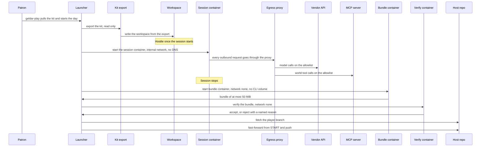

# Architecture

This repo builds the player kit. A player runs their character from it, and the character's memory lives in a repo the player owns. The design is spec section 5.15, as changed by the geldar records in [decisions.md](decisions.md).

## Outputs and the mock world

| Part | Lives in | Published as |
|---|---|---|
| The template: player-facing files only | `template/` in this repo | `SandboxServers/geldar-player-template` |
| The kit image: companion servers, verifier, egress proxy, pinned vendor CLI | `packages/`, `image/` | GHCR, pinned by digest in each `player.json` |
| The launcher `geldar-play` (bash and PowerShell) | `launcher/` | Signed assets on this repo's GitHub releases |
| The mock world, a stand-in for the Geldar MCP server | `threshold/mcp-mock/` in the geldar repo (0008) | GHCR, used by CI and by people trying the kit |

The mock world speaks the real contract. Its OAuth is stubbed by a per-player bearer token. Pointing a player at the real Threshold MCP server later changes `player.json` and the allowlist, not the kit.

## One play session

## Harnesses

| Harness | Loop owner | How it starts | Tools it can use |
|---|---|---|---|
| Claude | The vendor CLI | `claude -p ...`, started by the supervisor | World, memory and git tools over MCP, plus the vendor's permitted file tools under the managed settings |
| ChatGPT | The kit's loop, `geldar-chatgpt run` | `geldar-chatgpt run`, started by the supervisor | World, memory and git tools over MCP plus three bounded file tools; no shell |
| Local (planned) | The kit's loop over a chat completions server | Not built | Not built |

The Claude and ChatGPT harnesses read the same character files and keep the same memory, so a player can change harness and keep its memory.

## The packages

| Package | Binary | Role |
|---|---|---|
| `path-rule` | none | The one path rule, the modes (`play`, `setup`) and the noreply identity. Imported by the three below. |
| `memory` | `geldar-memory` | Read-only MCP `recall` of the character's memory. |
| `git` | `geldar-git` | MCP `commit_memory`. The only writer of commits, through plumbing. |
| `verify` | `geldar-verify` | The gate on the host: checks a bundle against the same path rule and the START commit. |
| `stub-cli` | `claude` (stub) | Scripted stand-in for the vendor CLI. CI only, never shipped. |
| `supervisor` | `geldar-supervisor` | The run loop inside the player container. |
| `keeper` | `geldar-keeper` | The gate and push, run by the keeper service of the player group. |
| `chatgpt` | `geldar-chatgpt` | Sign-in and the ChatGPT loop (`run`). |

At a session end: `geldar-git` makes the commits in the workspace, the bundle container bundles the branch, and `geldar-verify --bundle --start --branch --mode --player-id` answers `{"ok":...,"reasons":[...]}` with stable reason ids. Only an accepted bundle is fetched. Packages: [path-rule](../packages/path-rule/README.md), [memory](../packages/memory/README.md), [git](../packages/git/README.md), [verify](../packages/verify/README.md), [stub-cli](../packages/stub-cli/README.md).

## Trust boundaries

- **Host repo and git login** (trusted): the owner's machine and the credentials the launcher uses to push.
- **Kit export** (trusted, read only): what the launcher copies out of the host repo for one day.
- **Workspace** (hostile after the session starts): anything the character's session can write, including memory and skills.
- **Bundle** (hostile data): the commits that come back. The verifier checks them before anything is fetched into the host repo.
- **CLI home volume** (per player, holds the vendor login and Geldar tokens): mounted only into the session container. The bundle and verify containers never see it.

## Settings layers

Each layer owns a different part of the rule set.

| Layer | File | Holds |
|---|---|---|
| Managed (image) | `image/settings/managed.json` | Deny `Bash`, `WebFetch`, `WebSearch`; deny `Read`, `Edit` and `Write` of the CLI home and credentials; `blockReadsOutsideWorkingDirectories`; `autoMemoryEnabled: false` |
| Project (template) | `template/.claude/settings.json` | Model, effort, `defaultMode`; allow the Geldar, memory and git tools, `Read(/**)`, `Edit` and `Write` under `/memory/**` and `/skills/**`; deny edits to the kit files; hooks |
| Play (image, `--settings`) | `image/settings/play.json` | Deny `Edit` and `Write` of `/memory/identity.md` (write-once after birth, geldar 0015) |
| Setup (image, `--settings`) | `image/settings/setup.json` | Deny every `mcp__geldar__*` world tool, so setup can't play |

The launcher's gate (`geldar-verify`) enforces the same path rules on the commits that come back, so a settings mistake is caught a second time (geldar 0011).
